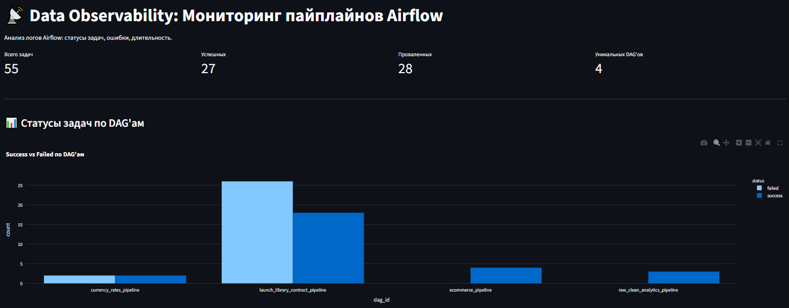
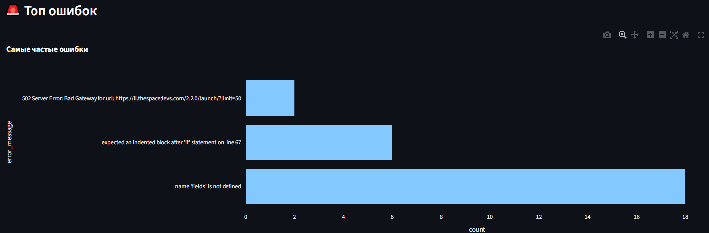
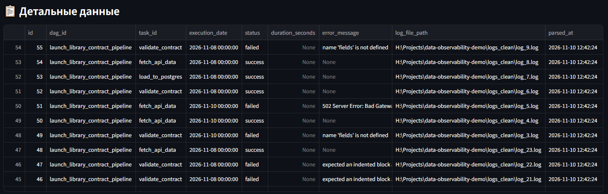
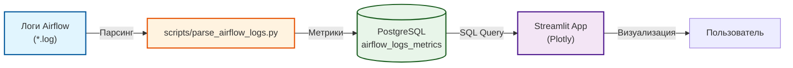

# 📡 Data Observability Demo

Pet-проект: мониторинг пайплайнов Apache Airflow на основе парсинга логов. Демонстрирует подход к Data Observability (наблюдаемости данных).

## 📸 Скриншоты

**1. Общие метрики и статусы задач по DAG'ам:**



**2. Топ ошибок:**



**3. Детальные данные по задачам:**



## 🎯 Зачем это

Data Quality (Soda, Great Expectations) проверяет **сами данные**. Data Observability проверяет **процесс**: как долго выполняются задачи, какие ошибки возникают, сколько задач падает. Этот проект показывает, как из сырых логов Airflow получить полезные метрики и визуализировать их.

## 🏗 Архитектура



## 📂 Структура

```
data-observability-demo/
├── scripts/
│   └── parse_airflow_logs.py    # Парсер логов Airflow
├── app/
│   └── streamlit_app.py         # Дашборд (Streamlit + Plotly)
├── assets/                      # Скриншоты для README
├── README.md
└── requirements.txt
```

## 🚀 Запуск

### 1. Скопируйте логи Airflow
Логи должны быть в папке `logs_clean` (или в любой папке, путь к которой указан в `parse_airflow_logs.py`).

### 2. Запустите парсер
```bash
pip install psycopg2-binary
python scripts/parse_airflow_logs.py
```

### 3. Запустите дашборд
```bash
pip install streamlit plotly pandas sqlalchemy
streamlit run app/streamlit_app.py
```

## 📊 Результаты

- **Всего задач:** 42 (31 реальный лог + 11 синтетических для демонстрации).
- **Уникальных DAG'ов:** 4 (`launch_library_contract_pipeline`, `ecommerce_pipeline`, `currency_rates_pipeline`, `raw_clean_analytics_pipeline`).
- **Топ ошибок:** `name 'fields' is not defined` (9 раз), `502 Server Error` (1 раз), `TimeoutError` (синтетика).

## 🔗 Связанные проекты

- [`data-governance-platform`](https://github.com/nconichtchenko-arch/data-governance-platform) — управление данными.
- [`grafana-postgres-monitoring`](https://github.com/nconichtchenko-arch/grafana-postgres-monitoring) — мониторинг инфраструктуры.
- [`api-data-contracts`](https://github.com/nconichtchenko-arch/api-data-contracts) — контракты данных (логи которого мы парсили).

## 📫 Контакты

- **GitHub:** [github.com/nconichtchenko-arch](https://github.com/nconichtchenko-arch)
- **Email:** pavloni@mail.ru
- **Формат работы:** удалённо

